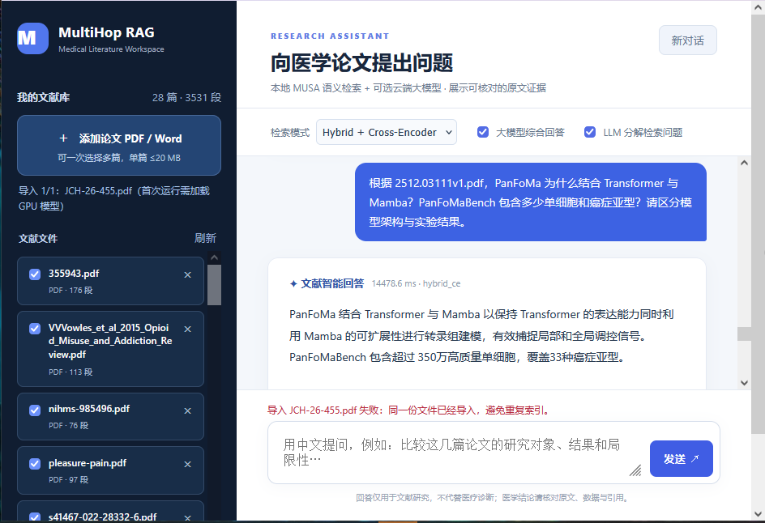
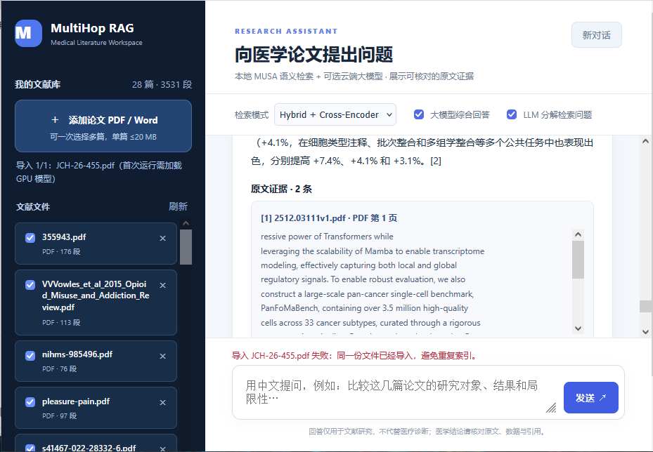

# MultiHop-RAG

<p align="center">
  <strong>基于 MUSA GPU 的本地医学文献检索增强生成系统</strong><br>
  <sub>Medical Literature Retrieval-Augmented Generation on Moore Threads MUSA</sub>
</p>

<p align="center">
  
  
  
  
  
</p>

**MultiHop-RAG** 是一个面向医学论文阅读和研究的本地 RAG 原型。用户可以上传 PDF / Word 文献，选择文献范围，用中文向英文或中文医学论文提问；系统在 **MTT S4000（MUSA）** 上完成 BGE-M3 语义检索、Cross-Encoder 精排，并调用本地 **Qwen2.5-Instruct** 生成带文献证据的回答。

本项目强调**可核查的原文证据**：展示文件名、PDF 页码和片段；对于无法通过基本引用校验的生成结果，v0.5 提供**原文摘录回退**，而非把未经核查的生成内容直接当作研究结论。

> [!IMPORTANT]
> **研究原型，不用于临床诊断、处方或治疗决策。** 检索相关不等于医学事实正确；引用编号与页码、研究设计、样本量、HR/OR/置信区间及因果表述均应核对原论文。当前程序无用户身份认证，请仅绑定 `127.0.0.1` 并使用 SSH 隧道访问，勿直接暴露公网。

## 界面预览

**文献管理、Hybrid + Cross-Encoder 检索与中文问答**



**论文证据、引用编号与 PDF 页码**



> 两图为真实使用截图，展示了 `2512.03111v1.pdf`（PanFoMa）相关提问。截图中的文献数、耗时和答案仅反映当时的测试环境，不代表通用性能或临床准确率。截图也包含重复导入 PDF 被拒绝的提示，这是按文件内容去重的预期行为。

## 目录

- [项目功能](#项目功能)
- [系统架构](#系统架构)
- [环境与硬件](#环境与硬件)
- [部署指南](#部署指南)
- [使用示例](#使用示例)
- [已有实验与性能记录](#已有实验与性能记录)
- [测试与复现](#测试与复现)
- [代码结构](#代码结构)
- [限制与安全说明](#限制与安全说明)

## 项目功能

| 功能 | 实现方式 / 当前范围 |
| --- | --- |
| 医学文献导入 | 支持文本型 **PDF、DOCX、TXT、Markdown**；每文件最大 20 MB，PDF 最多 150 页；可多文件选择和重复文件检测 |
| 文档持久化 | SQLite 存储文档、分块、向量；FTS5 支持关键词检索；重新启动后保留文献索引 |
| 多语言检索 | **BGE-M3** 1024 维语义向量，支持中文问题检索英文医学原文 |
| 检索模式 | `bm25`、`hybrid`、`hybrid_ce` 三种模式；Hybrid 通过 RRF 融合稀疏与稠密结果 |
| 精排 | **bge-reranker-v2-m3 Cross-Encoder**，默认对前 40 个候选进行 MUSA 推理精排 |
| 答案生成 | 本地 **Qwen2.5-1.5B-Instruct / Qwen2.5-7B-Instruct**；亦可对接符合 Chat Completions 协议的其他服务 |
| 问题规划 | 可选 LLM 检索式分解（最多 3 个新增子查询）；属于启发式检索增强，不等于已验证的完整多跳推理 |
| 证据展示 | 原文片段、文献文件名、PDF 页码、引用编号与检索耗时 |
| 安全回退 | 基础主题过滤、引用编号校验和数值检查；生成答案校验失败时展示**带来源的原文摘录**，并标明并非综合医学结论 |
| Web 交互 | 单机轻量 HTTP 服务 + 原生 HTML/CSS/JS，无需另起前端框架 |

## 系统架构

```text
用户（浏览器 / 中文问题）
        │
        ├── PDF / DOCX / TXT / MD 上传
        │         └─ 文本提取 → 分块 → BGE-M3 向量化 → SQLite + FTS5
        │
        └── 选择文献 + 提问
                  │
                  ├─ 可选：LLM 生成检索子查询
                  │
                  ├─ BM25 / FTS5 检索
                  ├─ BGE-M3 稠密向量检索
                  │         └─ RRF 融合（Hybrid）
                  ├─ Cross-Encoder 精排（Hybrid + CE）
                  │
                  └─ 相关证据过滤 + Top-K 原文片段
                            │
                            ├─ Qwen2.5 本地生成（OpenAI-compatible API）
                            │         └─ 基础引用/数字校验
                            │
                            └─ 回答 + 原文证据 + PDF 页码
                               （校验未通过则使用原文摘录回退）
```

推理职责分离：**BGE-M3 与 Cross-Encoder** 在聊天主服务中使用 MUSA；**Qwen** 使用独立本地 API 服务。两个进程可以单独调试，也可以分端口测试 1.5B 和 7B。语义向量检索阶段对当前 SQLite 中的向量使用 NumPy 计算，适合小规模论文库，不是大规模 ANN 检索引擎。

## 环境与硬件

开发/验证环境（**示例环境，不是自动安装要求**）：

| 项目 | 已验证的示例配置 |
| --- | --- |
| GPU | **Moore Threads MTT S4000，48 GB 显存** |
| 加速后端 | **MUSA**（不是 CUDA） |
| Python | 3.10 |
| 基础 PyTorch | `torch 2.2.0` + `torch_musa 1.3.0`（AutoDL 镜像预装组合） |
| 语义嵌入 | `BAAI/bge-m3`，1024 维 |
| 精排模型 | `BAAI/bge-reranker-v2-m3` |
| 本地生成模型 | `Qwen/Qwen2.5-1.5B-Instruct` 和 `Qwen/Qwen2.5-7B-Instruct` |
| 模型存储 | 推荐放在数据盘，如 `/root/autodl-tmp/models/` |

> [!CAUTION]
> **不要在现成的 MUSA 环境中执行 `pip install -U torch` 或安装 CUDA 版 PyTorch。** 本地 Qwen 推荐使用仓库提供的 `.venv_musa_llm` 隔离 Python 上层依赖，并继承原环境的 `torch` / `torch_musa`。不同 MUSA 驱动、算子和 Transformers 版本可能需要单独适配。

## 部署指南

以下示例针对已配置 MUSA 的 AutoDL / Linux GPU 主机。所有路径均可按实际磁盘位置调整。

### 1. 克隆项目并检查 MUSA

```bash
git clone https://github.com/duukkid-arch/MultiHop-RAG.git
cd MultiHop-RAG

python - <<'PY'
import torch, torch_musa
print('MUSA available:', torch.musa.is_available())
if torch.musa.is_available():
    print('Device:', torch.musa.get_device_name(0))
PY
```

如果 MUSA 不可用，先使用与你的显卡/驱动匹配的官方环境；**本仓库不包含驱动和模型权重**。

### 2. 安装文献解析依赖，准备 BGE-M3 与精排模型

在原有 MUSA Python 环境中安装 PDF 解析器（不要随手升级 torch）：

```bash
python -m pip install 'PyMuPDF>=1.24,<2'
```

下载并放置模型权重，例如：

```text
/root/autodl-tmp/models/
├── bge-m3/
└── bge-reranker-v2-m3/
```

模型来源：

- [BAAI/bge-m3](https://huggingface.co/BAAI/bge-m3)
- [BAAI/bge-reranker-v2-m3](https://huggingface.co/BAAI/bge-reranker-v2-m3)

设置本地模型位置：

```bash
export BGE_MODEL=/root/autodl-tmp/models/bge-m3
export CE_MODEL=/root/autodl-tmp/models/bge-reranker-v2-m3
export HF_HOME=/root/autodl-tmp/hf_cache
export HF_HUB_OFFLINE=1
export TRANSFORMERS_OFFLINE=1

python -m mhrag_gpu_chat_musa.app --check
```

成功时应显示 MUSA 设备名、BGE 嵌入数组形状 `(2, 1024)` 以及 CE 分数。`--check` 仅为 GPU 冒烟测试，不代表端到端精度验收。

### 3. 单独部署 Qwen2.5 本地推理服务

首先创建隔离的本地 LLM 环境：

```bash
bash mhrag_local_llm_musa/setup_venv.sh
.venv_musa_llm/bin/python -m mhrag_local_llm_musa.preflight
```

下载模型到数据盘：

```bash
# 仅下载期间允许联网；在网络受限环境可自行评估第三方镜像
unset HF_HUB_OFFLINE TRANSFORMERS_OFFLINE
export HF_ENDPOINT=https://hf-mirror.com

.venv_musa_llm/bin/python -m mhrag_local_llm_musa.download_model --size 1.5b
.venv_musa_llm/bin/python -m mhrag_local_llm_musa.download_model --size 7b
```

> 权重大小会占用大量磁盘空间。可以只下载计划使用的模型。**7B 模型在 MTT S4000 上成功加载并完成过实际 API 生成调用**；具体推理显存需求随 dtype、输入长度和同时运行的进程变化。若生成出现大量重复符号，请检查本地模型加载精度和 MUSA 算子兼容性；不要仅凭 HTTP 200 判定回答质量。

**启动 7B 服务（终端 / screen A）：**

```bash
cd MultiHop-RAG
export LOCAL_SERVED_MODEL=qwen7b-local
export HF_HUB_OFFLINE=1
export TRANSFORMERS_OFFLINE=1

.venv_musa_llm/bin/python -u -m mhrag_local_llm_musa.server \
  --model /root/autodl-tmp/models/Qwen2.5-7B-Instruct \
  --host 127.0.0.1 --port 8002 --max-input-tokens 4096
```

**可选：启动 1.5B 对照服务（终端 / screen B）：**

```bash
export LOCAL_SERVED_MODEL=qwen-local
.venv_musa_llm/bin/python -u -m mhrag_local_llm_musa.server \
  --model /root/autodl-tmp/models/Qwen2.5-1.5B-Instruct \
  --host 127.0.0.1 --port 8001 --max-input-tokens 4096
```

两个模型同时常驻会额外占用显存；显存不足时仅运行一个模型。可以用 `screen -S qwen7b` 启动常驻终端，按 `Ctrl+A`、`D` 脱离。

检查模型服务：

```bash
curl -s http://127.0.0.1:8002/health
# 预期可看到："ok": true、"model": "qwen7b-local"
```

### 4. 启动医学文献聊天网页

**7B 网页（终端 / screen C，示例端口 7866）：**

```bash
cd MultiHop-RAG
export BGE_MODEL=/root/autodl-tmp/models/bge-m3
export CE_MODEL=/root/autodl-tmp/models/bge-reranker-v2-m3
export HF_HOME=/root/autodl-tmp/hf_cache
export HF_HUB_OFFLINE=1
export TRANSFORMERS_OFFLINE=1

export LLM_BASE_URL=http://127.0.0.1:8002/v1
export LLM_MODEL=qwen7b-local
export LLM_API_KEY=local-only
export LLM_TIMEOUT=240
export CHAT_ANSWER_SOURCES=4
export CHAT_CITATION_RETRY=0

python -u mhrag_gpu_chat_musa/app.py --host 127.0.0.1 --port 7866
```

若要保留旧版 1.5B 对照网页，可在另一个终端把 `LLM_BASE_URL` 改成 `http://127.0.0.1:8001/v1`、`LLM_MODEL=qwen-local`，并将网页端口设为 `7865`。默认情况下，两个网页使用相同的 SQLite 数据库，因此**不要在多个网页进程中同时执行大规模导入或删除操作**。

检查：

```bash
curl -s http://127.0.0.1:7866/api/health
# 应返回 ok: true 且 llm_configured: true
```

### 5. 从自己的电脑访问（SSH 隧道）

在**个人电脑**执行（替换为自己的 AutoDL SSH 参数）：

```bash
ssh -N -L 7866:127.0.0.1:7866 -p <SSH_PORT> root@<SSH_HOST>
```

然后浏览器打开 **http://127.0.0.1:7866**。请不要将无认证的 `7866`、`8002` 端口直接开放到公网。

### 6. 可选：接入其他兼容的 LLM API

聊天服务支持 OpenAI-compatible `POST /chat/completions`。在自己掌控的终端中配置 `LLM_BASE_URL`、`LLM_MODEL`、`LLM_API_KEY` 即可替代本地 Qwen。**使用云端模型会向服务提供方发送被选中的论文片段**；注意文献许可和敏感信息，切勿提交 API Key 或包含患者身份信息的资料。

## 使用示例

### 示例 A：计算生物学论文 PanFoMa

**示例提问：**

> 根据 `2512.03111v1.pdf`，PanFoMa 为什么结合 Transformer 与 Mamba？PanFoMaBench 包含多少单细胞和癌症亚型？请区分模型架构与实验结果。

**截图中的回答要点：** 使用 Transformer 编码局部基因相互作用、使用 Mamba 建模更大范围的上下文；PanFoMaBench 包含**超过 350 万个单细胞、33 种癌症亚型**。截图显示的同一次问答使用 `hybrid_ce` 检索、展示 2 条原文证据，端到端耗时约 **14.48 s**。

论文中报告的若干提升（如 7.4%、4.0%、3.1%）是 **PanFoMa 原论文作者的实验结果**，**不是本项目 RAG 模型的性能增益**。所有百分比都应以所引用论文及实验任务为准。

### 示例 B：临床研究统计结果

**示例提问：**

> 根据 `WPS-24-250.pdf`，中等剂量阿立哌唑联合较高剂量氯氮平，与同剂量氯氮平单药相比，精神病复发住院风险有何关联？请提供调整后风险比与 95% CI，并注明研究设计。

在已有单篇论文测试中，系统找到了含有 **aHR=0.68，95% CI 0.62–0.75** 的研究证据段落。这是来自该篇观察性研究的结局结果，**不能解释为药物治疗的因果效果**。此前测试也暴露过模型回答遗漏解释或引用格式不合格的问题，因此此示例主要用于测试统计值和证据定位，并非临床有效性验证。

### 示例 C：上传与证据不足

通过左侧上传按钮选择文件；选择检索模式 `Hybrid + Cross-Encoder`；勾选或取消需要参与检索的论文；开启“**大模型综合回答**”，可选“**LLM 分解检索问题**”。答案区会展示 `[1]`、`[2]` 等编号、文件名、页码及原文片段。重复上传相同文件会拒绝重复索引。

若相关证据不足，系统可能拒答或提供**【原文摘录模式】**。摘录仅是定位线索，不能视为已回答所有医学问题。

## 已有实验与性能记录

本节**仅记录已有运行日志或可见截图支持的结果**，明确区分组件运行检查、单次应用案例和历史离线检索指标。它们使用的输入、任务及计时范围不同，**不可直接做模型速度排行榜**。

### 1. 已完成的组件 / 服务验证

| 项目 | 已观察到的结果 | 解释 |
| --- | --- | --- |
| MUSA GPU 嵌入冒烟测试 | BGE-M3 输出 `(2, 1024)` | 模型可在 MUSA 上执行，非准确率指标 |
| MUSA CE 冒烟测试 | 返回有效精排分数 | 精排模型可完成前向推理，非召回率指标 |
| Qwen2.5-1.5B | 多次成功生成正常中文 | 曾有异常重复符号，精度/运行配置需要正确设置 |
| Qwen2.5-7B | 4/4 个权重分片被检测到；在 MTT S4000 成功加载；8002 接口有 3 次 HTTP 200 生成请求 | **HTTP 成功不等于医疗回答准确** |
| 证据主题过滤 | 一次氯氮平测试返回 2 条同一目标论文的相关片段（2/2） | 仅说明该次关键词相关性检查通过 |
| v0.5 原文摘录回退 | 已在真实问答中触发，保留论文及页码 | 展示可靠的源文定位，不自动保证结论正确 |
| PanFoMa 页面示例 | `hybrid_ce`，单次耗时 14,478.6 ms；界面示例显示 28 篇文献、3,531 段 | **单次演示值**，包含检索与生成；非平均值、P95 或跨硬件结果 |

### 2. 历史离线检索结果（与聊天网页评测严格区分）

此前独立的 **v4 检索实验记录**，使用带金标准证据的问答数据，报告如下 holdout 文档级 **All-Gold@10**：

| 历史方法 | Holdout All-Gold@10 |
| --- | ---: |
| CE@100（v4 基线） | **76.88%** |
| Decompose + CE@100（v4） | **77.62%** |

**口径说明：** All-Gold@10 指单个问题的全部标注金标准证据文档都出现在前 10 个检索结果中。这些数字来自既有历史实验记录，**尚未在本 README 所对应的公开代码快照中附上完整可复算的原始产物**。它们不属于目前 7B 聊天系统的端到端正确率，也不能用来推断生成模型医疗回答准确率或响应延迟。当前源码中的 `mhrag_v6_musa/` 与 `mhrag_v7_8h/` 为独立实验工具，不应与上述 v4 结果混为一谈。

## 测试与复现

**聊天服务单元测试：**

```bash
python -m unittest discover -s mhrag_gpu_chat_musa/tests -p 'test*.py' -v
python -m unittest discover -s mhrag_local_llm_musa/tests -p 'test*.py' -v
```

**真实 MUSA 环境检查：**

```bash
python -m mhrag_gpu_chat_musa.app --check
curl -s http://127.0.0.1:8002/health
curl -s http://127.0.0.1:7866/api/health
```

**重点人工核查：** PDF 页码是否正确、研究方法与人群是否混淆、HR/OR 与 95% CI 是否对应同一结局、引用是否能定位到真实段落，以及跨论文结论是否存在无依据扩展。单元测试和服务健康检查不能替代这些核查。

## 代码结构

```text
MultiHop-RAG/
├── README.md                         # 项目总览与部署说明
├── docs/images/                      # README 真实界面截图
├── mhrag_gpu_chat_musa/              # 文献上传、SQLite、MUSA 检索、CE 精排、Web/API
│   ├── app.py                        # HTTP 服务，默认 7865
│   ├── core.py                       # 检索与问答流程
│   ├── gpu.py                        # BGE-M3、Cross-Encoder MUSA 推理
│   ├── parser.py                     # PDF / Word / 文本解析
│   ├── store.py                      # SQLite + FTS5
│   ├── llm.py                        # Chat Completions 调用与可选检索规划
│   ├── web/                          # 原生前端
│   └── tests/                        # 自动测试
├── mhrag_local_llm_musa/             # 本地 Qwen 下载、环境预检、推理 API
├── mhrag_v6_musa/                    # 独立的 MUSA 检索实验代码
└── mhrag_v7_8h/                      # 独立的历史实验分析与性能测试工具
```

原仓库可能同时包含已经合并到 `mhrag_gpu_chat_musa/` 的证据防护模块。模型权重、论文 PDF、个人数据、SQLite 数据库、实验日志和缓存**不应提交到公开仓库**。

## 限制与安全说明

- **单用户研究原型**：不提供账号系统、细粒度权限、服务端速率限制或公网级安全加固。
- **PDF 限制**：扫描版 PDF 需要额外 OCR；复杂双栏、表格、公式或跨页结果可能提取不完整；PDF 页码是文件页面序号，不一定等于期刊印刷页码。
- **证据不完整**：固定分块与片段截断可能将 HR、CI 和对应结局拆开；参考文献页也可能被检索命中。
- **生成与引用不等同**：形式正确的 `[1]` 不证明其支持回答中的每条结论；基础数值核验不能全面检查统计归属、因果推断或研究偏倚。
- **跨论文问题**：启发式分解与 CE 精排未必能召回所有必需文献；当证据不足时应拒绝推断，而非凭常识补齐。
- **隐私与许可**：处理真实患者资料之前需合规评估；第三方论文的版权不因本地下载而改变；公开仓库不包括受许可限制的论文全文或数据库。
- **版本与可移植性**：MUSA 软硬件生态对驱动/算子版本敏感；初次部署必须自行检查模型文件与推理环境。

## 致谢与引用

本项目使用或参考以下开源模型与基础组件，请遵循各自许可和使用条款：

- [BAAI / BGE-M3](https://huggingface.co/BAAI/bge-m3)
- [BAAI / bge-reranker-v2-m3](https://huggingface.co/BAAI/bge-reranker-v2-m3)
- [Qwen / Qwen2.5-Instruct](https://huggingface.co/Qwen)
- [PyTorch](https://pytorch.org/) 与 [torch_musa](https://github.com/MooreThreads/torch_musa)

项目当前定位为研究原型。**仓库尚未声明统一开源许可证时，不能默认所有内容都已获得自由再分发授权。**
