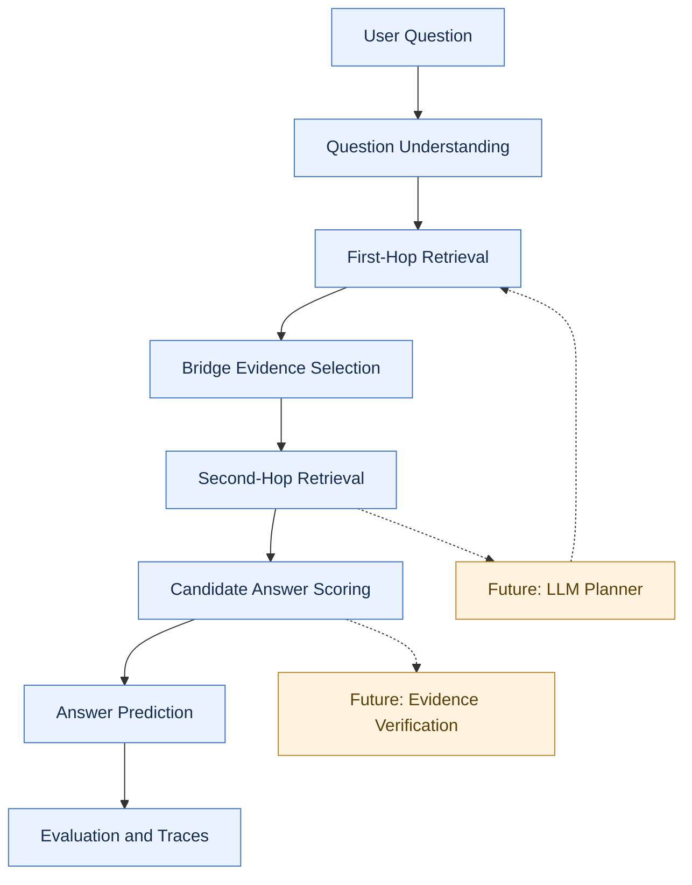

# MultiHop-RAG: Agentic Multi-Hop Retrieval and Reasoning

**An experimental framework for Agentic Retrieval-Augmented Generation (Agentic RAG), multi-hop evidence retrieval, and reproducible reasoning benchmarks.**

This repository investigates how retrieval agents can **plan searches, follow evidence across documents, verify answers, and evaluate reasoning trajectories**. The immediate focus is the original **MedHop** benchmark, where a model must select the correct answer from candidates using supporting passages.

> **Current implementation status:** The included MedHop `agentic` mode is a **heuristic two-hop retrieval baseline**, not yet an LLM-directed autonomous agent. LLM planning, tool selection, and evidence verification are planned extensions. Benchmark scores are reported only after experiments have been run.

## Why Agentic RAG?

Ordinary RAG typically retrieves evidence once and then predicts an answer. Agentic RAG aims to adapt the retrieval process to the evidence already seen:

1. **Understand the task** and identify entities and candidate answers.
2. **Retrieve first-hop evidence** relevant to the original question.
3. **Follow a bridge** by selecting intermediate passages or entities.
4. **Retrieve additional evidence** to connect the starting entity to a candidate answer.
5. **Verify and answer** using the evidence path; record the retrieval trace for inspection.

The current heuristic implementation approximates steps 2–4 with deterministic TF-IDF and similarity scoring. Later experiments will replace fixed heuristics with explicit LLM-based planning and verification.

## Agentic RAG Architecture / 系统架构

This diagram explains the retrieval and reasoning pipeline.

本图展示 Agentic RAG 的检索、证据处理和答案生成流程。当前 MedHop 基线采用启发式多跳检索；LLM 自主规划与证据验证属于后续扩展。



### How the System Works / 运行原理

1. **Question Understanding / 问题理解**：识别问题实体和候选答案。
2. **First-Hop Retrieval / 第一跳检索**：检索相关支持文档。
3. **Bridge Selection / 桥接选择**：确定有助于下一跳检索的中间证据。
4. **Second-Hop Retrieval / 第二跳检索**：利用桥接证据扩展搜索。
5. **Answer Scoring / 答案评分**：对候选答案进行证据相关性评分。
6. **Evaluation / 实验评估**：记录预测结果、准确率和检索轨迹。

### Implementation Status / 实现状态

| Component | Status |
| --- | --- |
| Single-hop TF-IDF retrieval | Implemented |
| Heuristic two-hop retrieval | Implemented |
| MedHop validation evaluation | Implemented |
| LLM-based autonomous planning | Planned |
| Evidence verification for MedHop | Planned |

The repository also contains modular evidence-verification experiments. These are separate from the original MedHop heuristic baseline and must be evaluated independently.

## Repository components

| Component | Purpose | Status |
| --- | --- | --- |
| `mhrag_v13_modular_starter/` | Existing modular retrieval and benchmark infrastructure | Existing project code; see its own documentation |
| `mhrag_v13_modular_starter/benchmarks/medhop/` | MedHop benchmark integration and offline checks | Existing project code |
| `medhop_agentic/medhop_pipeline.py` | Per-question retrieval and candidate-answer scoring | Implemented baseline |
| `medhop_agentic/run_full_experiment.sh` | Full validation comparison of two retrieval modes | Implemented script |
| `medhop_agentic/README.md` | Detailed dataset assumptions, commands, and limitations | Documentation |

Directory names above describe the intended integrated repository layout; check your branch for the available files.

## MedHop experiment

**Task.** Given `query`, `supports`, and `candidates`, predict a candidate answer; use the gold `answer` field for evaluation only. Support passages are retrieved **within each question's provided documents**, not from a shared global corpus.

**Baseline A — Single-hop retrieval (`single`)**  
Uses TF-IDF relevance to retrieve supporting passages and rank candidate answers.

**Baseline B — Heuristic two-hop retrieval (`agentic`)**  
Uses first-hop evidence to identify bridge passages, expands retrieval based on similar documents, and scores candidate answers with evidence from multiple passages. This is an *agentic-style retrieval baseline*; it does not autonomously call an LLM or choose its own tools.

### Run full validation on AutoDL

The following commands assume the `medhop_agentic/` directory has been added to this repository and the MedHop dataset is available locally.

```bash
cd medhop_agentic
python -m pip install -r requirements.txt
bash run_full_experiment.sh /root/autodl-tmp/medhop_benchmark_private/medhop_original
```

By default, the script evaluates the entire MedHop **validation** split in both modes. The previously prepared local dataset was reported as **1,620 training** and **342 validation** examples; these counts are environment-specific and are not reverified by this README.

### Outputs

```text
medhop_agentic/results/
  single_validation.jsonl
  single_validation_metrics.json
  agentic_validation.jsonl
  agentic_validation_metrics.json
```

Each prediction record contains an answer, gold label (when present), and retrieval trace. Metric JSON files contain scored count, exact-match accuracy when labels exist, and elapsed time. **No measured accuracy is claimed in advance.**

## Agentic research roadmap

- **Stage 1 — Reproducible baselines:** single-hop versus deterministic two-hop retrieval; inspect failures and retrieval traces.
- **Stage 2 — Retrieval upgrades:** BM25 and dense retrieval under consistent candidate sets and support-document conditions.
- **Stage 3 — LLM agent:** planner decides whether to retrieve again, selects search actions, and terminates when evidence is sufficient.
- **Stage 4 — Evidence verification:** assess support-chain consistency and reject unsupported answers.
- **Stage 5 — Ablations and reporting:** compare accuracy, latency, retrieval steps, evidence coverage, and compute cost.

The roadmap is a **plan**, not a statement that all stages are already implemented.

## Reproducibility and responsible data handling

- Run evaluation on held-out validation examples and do not use the gold answer for prediction.
- Preserve retrieval traces and experiment configuration for ablation studies.
- Do not commit private datasets, access tokens, model checkpoints, or large output artifacts.
- Consult the MedHop dataset's own terms and citation guidance before redistribution or publication.

## Development

Use feature branches and pull requests for experimental changes. Keep new approaches comparable against the same validation split, candidate answers, and evaluation metric.
