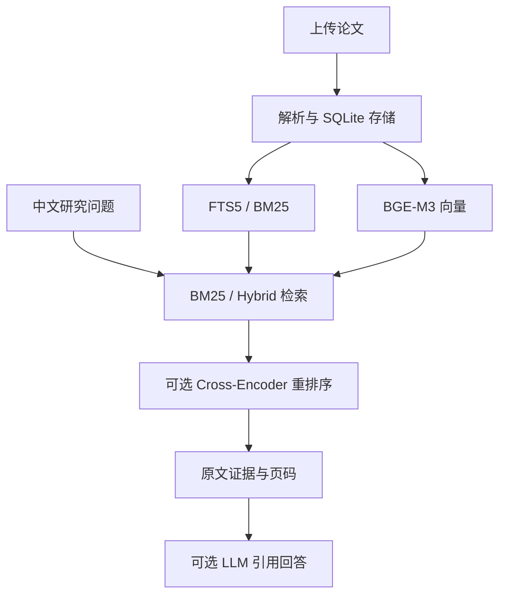

<<<<<<< HEAD
# MultiHop-RAG｜医学文献智能检索与问答系统

**Medical Literature Research Assistant · Hybrid Retrieval · Cross-Encoder · MUSA GPU**

面向医学科研的本地文献检索增强问答（RAG）原型。支持导入多篇医学论文，以 BM25 与 BGE-M3 混合检索查找证据，使用 Cross-Encoder 重排序，并可通过兼容 Chat Completions 的大语言模型生成带原文引用的中文回答。仓库还包含独立的 v6/v7 文献级检索评测实验。

> **定位**：科研文献辅助阅读与证据查找工具，不是医疗诊断或临床决策系统。当前聊天应用是单用户本地原型，不建议直接向公网开放。

## 界面展示


截图展示文献库、上传入口、检索模式、可选大模型回答及引用原文；属于功能演示，不代表回答准确率评测。

## 核心功能

| 功能 | 说明 |
| --- | --- |
| 多文档导入 | PDF、DOCX、TXT、MD；支持批量选择、去重、删除及 SQLite 持久化 |
| 混合检索 | FTS5/BM25 关键词检索与 BGE-M3 语义检索，可选 Hybrid 模式 |
| 重排序 | MUSA GPU Cross-Encoder 重排序（聊天模式候选数 40） |
| 跨语言检索 | 中文提问检索英文医学论文，效果依赖模型与语料 |
| 证据追溯 | 显示文件名、文本型 PDF 页码与原文片段 |
| 大模型回答 | 可选 OpenAI-compatible Chat Completions API，生成带 `[1]` 等引用的中文回答 |
| 问题分解 | 可选 LLM 将问题拆分为最多 3 个子问题；尚未验证为完整多跳算法 |
| 无云端 API 使用 | 即使没有 LLM Key，也可使用本地检索与原文证据展示 |

单文件上限 **20 MB / 150 页**。扫描型 PDF 暂不支持 OCR；复杂双栏、图表需人工核对。

## 系统架构



本地完成文档索引和检索，BGE-M3 使用 1024 维向量。启用云端 LLM 后，仅将选出的必要证据片段发送给所配置的模型服务；请注意文献使用权限与数据隐私。

## 聊天系统部署（MTT S4000 / MUSA）

以下针对预先安装了 **MUSA 兼容 PyTorch、torch_musa、sentence-transformers、transformers、numpy** 的摩尔线程 MTT S4000 环境；**不是 NVIDIA CUDA 的通用安装教程**。还需预先准备本地 BGE-M3 和 BGE reranker v2 m3 模型。不要无差别 `pip install` 并替换 MUSA 版 PyTorch。

### 1. 下载与自检

```bash
git clone https://github.com/duukkid-arch/MultiHop-RAG.git
cd MultiHop-RAG
python -c "import torch, torch_musa; print(torch.musa.is_available())"
python -m mhrag_gpu_chat_musa.app --check
```

需要先确保 v6/v7 GPU 实验没有同时运行，以免显存争用。`--check` 用于测试嵌入、重排序等组件，并不自动安装驱动或模型。

### 2. 配置本地模型

```bash
export HF_HOME=/root/autodl-tmp/hf_cache
export HF_HUB_OFFLINE=1
export TRANSFORMERS_OFFLINE=1
export BGE_MODEL=/root/autodl-tmp/models/bge-m3
export CE_MODEL=/path/to/local/bge-reranker-v2-m3/snapshot
```

以上为示例路径，按实际存储位置修改。PDF 解析需 `PyMuPDF`、`pypdf` 或 `pdftotext` 中至少一种；如缺少，可单独安装 `PyMuPDF>=1.24,<2`，避免改变 torch。

### 3. 可选连接大语言模型

```bash
read -rsp 'LLM API Key: ' LLM_API_KEY; echo
export LLM_API_KEY
export LLM_BASE_URL='https://api.openai.com/v1'
export LLM_MODEL='gpt-4.1-mini'  # 按所使用服务及权限修改
```

兼容服务需支持 `POST /chat/completions`。不要把 Key 上传 GitHub。使用云端回答时，原文证据片段会发送给对应服务提供商，可能产生费用。

### 4. 启动网页

```bash
python -u mhrag_gpu_chat_musa/app.py --host 127.0.0.1 --port 7865
```

在服务器检查 `curl -s http://127.0.0.1:7865/api/health`。如果是远程 GPU 机器，在自己的电脑建立 SSH 转发（替换实际账户、地址、端口）：

```bash
ssh -N -L 7865:127.0.0.1:7865 -p SSH_PORT USER@HOST
```

之后本机访问 **http://127.0.0.1:7865**。保持服务器绑定 `127.0.0.1`，不要将这个尚无身份认证的原型直接开放公网。更详尽的部署与检查点恢复步骤见 [聊天系统 README](mhrag_gpu_chat_musa/README.md)。

### 5. 自动化测试

```bash
python -m unittest discover -s mhrag_gpu_chat_musa/tests -p 'test*.py' -v
```

离线测试使用 Mock Encoder，不能替代实际 MUSA GPU 与在线 LLM 的端到端验证。

## 使用方法

1. 打开页面，上传有权处理的 PDF/Word 论文，等待首次嵌入和索引完成。
2. 勾选参与检索的文件，选择 **BM25 / Hybrid / Hybrid + Cross-Encoder** 模式。
3. 按需启用“大模型综合回答”和“LLM 分解检索问题”。
4. 用中文提出跨论文比较或证据总结问题。
5. 检查答案中的引用编号、文件名、PDF 页码及原文片段，必要时返回原论文核验。

## 模型性能与研究实验

**离线检索实验与聊天系统是两条不同评测路线，不应混用其结果。**

| 项目 | 实验内容 | 当前仓库可核实状态 |
| --- | --- | --- |
| v6 | 750 字符重建文本块；BM25/Hybrid 与 CE；文档级 All-Gold@10、Coverage@10 | 脚本和方法说明已提交；文档描述 609 篇文章文本、2,255 道标注问题 |
| v7 | 利用 v6 缓存研究 CE 候选数 K=20/30/60/100 的质量预算，并可测 MUSA CE 延迟 | 脚本和运行说明已提交；仓库中暂无可验证的最终统计报告 |
| GPU 聊天 | 导入、检索、证据展示和可选生成回答 | 提供自动化测试和 GPU 自检；暂无统一的公开端到端准确率结果 |

### 待补充的实测结果

| 检索方案 | All-Gold@10 | Coverage@10 | 耗时 |
| --- | ---: | ---: | ---: |
| BM25 | 待实验结果 | 待实验结果 | 待实验结果 |
| Hybrid | 待实验结果 | 待实验结果 | 待实验结果 |
| Hybrid + CE | 待实验结果 | 待实验结果 | 待实验结果 |

目前仓库没有可核验的最终 `per_query.csv`、`V7_BUDGET_REPORT.json` 等输出，因此不编造 Recall、准确率、加速比。后续应注明数据集、DEV/HOLDOUT 划分、硬件、运行时间及统计置信区间。

v7 的 K 预算分析基于已缓存的 CE 分数；它是**回顾性模拟**，不是实测端到端加速。按真实问题类型标签选择 K 是 **oracle 策略**，并非已部署的分类器。v5 HOLDOUT 已多次检查，也不能声称为全新盲测。详见 [v6 说明](mhrag_v6_musa/README.md)及 [v7 说明](mhrag_v7_8h/README.md)。

## 项目结构

```text
MultiHop-RAG/
├── README.md                     # 项目首页
├── docs/images/                  # 聊天截图
├── mhrag_gpu_chat_musa/          # 聊天前后端与测试
├── mhrag_local_llm_musa/         # 本地模型服务相关代码
├── mhrag_v6_musa/                # v6 检索实验
├── mhrag_v7_8h/                  # v7 候选预算与延迟实验
├── mhrag_evidence_guard_v02/     # 证据防护实验
├── mhrag_evidence_focus_v03/     # 证据聚焦实验
├── mhrag_answer_repair_v04/      # 答案修复实验
└── mhrag_answer_fallback_v05/    # 安全回退实验
```

## 局限与安全提醒

- 当前向量检索适合小型科研文献集（如 10–50 篇），并非大规模生产级向量数据库。
- 扫描 PDF、复杂医学表格、图像及双栏排版可能解析不全；大模型回答及引用仍需人工核对。
- LLM 问题分解是启发式功能，不等同于已通过独立基准验证的完整多跳推理能力。
- 尚无用户认证、公开服务滥用防护与临床安全验证；不要导入患者敏感数据或未经授权的论文。

---

更多细节：[聊天系统部署](mhrag_gpu_chat_musa/README.md) · [v6 实验](mhrag_v6_musa/README.md) · [v7 实验](mhrag_v7_8h/README.md)
=======
# v6 750-character BM25 vs Hybrid, native MUSA edition

Designed for the AutoDL MTT S4000 image with **torch 2.2.0 + torch_musa 1.3.0** pre-installed. No CUDA and no torchada needed at first. This bundle contains an independent copy of the retrieval and CE scripts with explicit `musa` devices. Native MUSA support still needs validation; not all operators may work. `hybrid_musa.py` uses CPU NumPy for dense top-k of the small baseline corpus to avoid a potentially unsupported MUSA top-k operator. GPU remains responsible for BGE embedding and CE inference.

## Before starting
Copy existing project, original SQLite and dataset, v4 baseline files, local BGE model, and local reranker snapshot from NVIDIA instance. Existing v5 results are unnecessary. Check files using `python mhrag_v6_musa/run.py --dry-run`. Python environment should inherit or clone the AutoDL MUSA base, **never install CUDA torch**.

## Setup on new S4000
```
cd /root/autodl-tmp/MultiHop-RAG
unzip -o mhrag_v6_musa.zip
conda activate mhrag_musa
python mhrag_v6_musa/run.py --dry-run
python -u mhrag_v6_musa/smoke.py 2>&1 | tee /root/autodl-tmp/musa_smoke.log
```

If smoke succeeds:
```
cd /root/autodl-tmp/MultiHop-RAG
mkdir -p results/v6_focus_750_musa
nohup python -u mhrag_v6_musa/run.py --root results/v6_focus_750_musa >results/v6_focus_750_musa/launcher.log 2>&1 </dev/null &
echo $!
tail -f results/v6_focus_750_musa/launcher.log
```

You must evaluate CPU vs MUSA outputs numerically before publishing cross-hardware performance comparisons. Check logs if `STATUS=FAILED`. The experiment only measures document-level evidence metrics and uses 609 reconstructed article texts, not a large external corpus.
>>>>>>> 694028da511d6bea1e9928b36ffa6a94e22d740a
