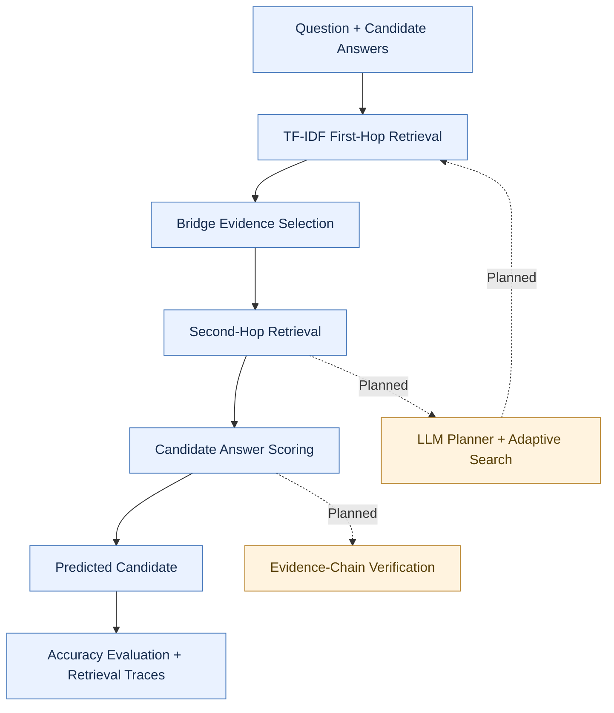

# MultiHop-RAG: Agentic Multi-Hop Retrieval and Reasoning

**An experimental research repository for multi-hop retrieval, evidence-grounded reasoning, and reproducible Agentic RAG evaluation.**

MultiHop-RAG explores how retrieval systems move beyond a single search to follow evidence across documents, assess candidate answers, and record auditable reasoning traces. It includes an **original MedHop benchmark baseline** alongside a **separate modular evidence-grounding research pipeline**.

> **Research status:** The MedHop `agentic` mode evaluated below is a **deterministic, heuristic two-hop baseline**, **not** an autonomous LLM agent. A modular claim-generation and evidence-verification pipeline also exists in this repository, but its metrics are **not interchangeable** with MedHop answer-selection accuracy. Features marked *Planned* below are not claimed as completed.

## At a glance

| Area | What it does | Status |
| --- | --- | --- |
| MedHop single-hop | TF-IDF retrieval and candidate-answer scoring | Implemented; evaluated |
| MedHop heuristic two-hop | Bridge-passage expansion and candidate-answer scoring | Implemented; evaluated |
| BM25 / additional retrieval strategies | Retrieval ablations | Experimental; check branch for code and results |
| Modular evidence-grounding | Study routing, evidence harvesting, claim checks, abstention | Separate experimental pipeline |
| LLM-controlled retrieval planner for MedHop | Dynamically selects retrieval actions and stopping conditions | Planned |
| MedHop evidence-chain verification | Verifies whether answer chains support a chosen candidate | Planned |

## Why Agentic RAG?

Single-pass RAG retrieves evidence once. Agentic RAG research asks whether a system can **decompose the question**, **decide what to retrieve next**, **connect evidence across hops**, **check support**, and **stop or abstain** when evidence is insufficient. The measured MedHop baseline below implements fixed two-hop behavior; it does not yet make autonomous tool-use decisions.

## System architecture

The **solid arrows** show the currently implemented *MedHop heuristic baseline*. **Dashed arrows** denote planned MedHop agent extensions.



**运行原理：** 输入问题与候选答案 → 第一跳检索 → 桥接证据选择 → 第二跳检索 → 候选答案打分 → 保存预测、准确率和检索轨迹。上图中的 LLM Planner 与 MedHop 证据链验证是后续研究方向，并非当前双跳基线的已实现能力。

The repository's **modular medical-literature evidence pipeline** separately includes study identity routing, evidence harvesting, claim generation, quote/number prechecks, coverage checks, and abstention decisions. Its automated checks **do not constitute clinical fact verification**, and its F/G or E2/E3 ablation metrics should not be reported as MedHop accuracy.

## Measured MedHop results

**Dataset:** original MedHop, validation split, **342 examples**. Each example's provided `supports` passages are the retrieval pool; the model chooses among that example's `candidates`. Gold `answer` labels are used only for evaluation.

| Configuration | Evaluated | Correct | Exact-match accuracy | Evaluation time* |
| --- | ---: | ---: | ---: | ---: |
| TF-IDF single-hop (`single`) | 342 / 342 | 35 | **10.23%** | 6.44 s |
| TF-IDF heuristic two-hop (`agentic`) | 342 / 342 | 39 | **11.40%** | 9.22 s |
| Difference (two-hop minus single-hop) | — | +4 | **+1.17 percentage points** | +2.78 s |

*Times are the per-mode script-reported evaluation durations from one AutoDL run, not controlled latency benchmarks. The overall shell run took **21.916 s** including overhead. Values are rounded; 35/342 and 39/342 reconstruct the reported accuracies.*

**Interpretation:** Two-hop scoring answered four more validation questions correctly in this run. This small gain is **not a claim of statistical significance**, generalization, or autonomous-agent effectiveness. No LLM-agent accuracy is reported. The raw run reported `OMP_NUM_THREADS` warnings; these did not prevent evaluation. The measured results were shared as terminal logs; per-example JSONL outputs are generated locally and should be archived with the exact commit and settings for independent replication.

## Repository layout

```text
MultiHop-RAG/
├── README.md
├── medhop_agentic/
│   ├── medhop_pipeline.py          # Single-hop / heuristic two-hop baselines
│   ├── run_full_experiment.sh      # Full validation run
│   ├── requirements.txt
│   └── README.md                   # Dataset and implementation notes
├── mhrag_v13_modular_starter/
│   ├── mhrag_v13/                  # Modular grounded-reasoning components
│   └── benchmarks/                # Separate benchmarks and tests
├── benchmarks/                    # Additional repository benchmarks
└── .github/workflows/             # Automated checks
```

*This is a guide to key entry points, not an exhaustive listing of every file or legacy directory. Refer to the selected branch for actual contents.*

## Reproduce the MedHop baseline

Requirements: Python environment with packages from `medhop_agentic/requirements.txt`; a **locally available** original MedHop dataset. Do not commit the private dataset to GitHub. The run script must be configured to locate your local dataset; inspect `medhop_pipeline.py --help` and the shell script for dataset-path options before running on a different machine.

```bash
# From the repository root
cd medhop_agentic
python -m pip install -r requirements.txt
export OMP_NUM_THREADS=1
bash run_full_experiment.sh
```

The reported AutoDL setup used the dataset directory:

```text
/root/autodl-tmp/medhop_benchmark_private/medhop_original
```

Expected output files (the script creates these on a successful run):

```text
medhop_agentic/results/
├── single_validation.jsonl
├── single_validation_metrics.json
├── agentic_validation.jsonl
└── agentic_validation_metrics.json
```

The baseline was reported to use **1,620 train** and **342 validation** records in the local prepared dataset. For scientific reporting, preserve the exact code commit, dataset revision, configuration, raw predictions, and environment in an experiment record. Do not infer a statistical confidence interval from rounded aggregate metrics alone.

## Research roadmap

1. **Established baseline:** TF-IDF single-hop versus heuristic two-hop on original MedHop.
2. **Retrieval ablations:** Compare BM25, dense or hybrid retrieval under identical data and candidate-answer conditions.
3. **Agent control:** Add LLM planning, adaptive follow-up retrieval, and explicit stopping decisions to MedHop.
4. **Evidence-chain verification:** Evaluate whether the retrieved chain actually supports the answer; distinguish unsupported answers from abstentions.
5. **Reproducible reporting:** Compare accuracy, coverage, latency, retrieval steps, and compute cost; publish ablations and error analysis with run metadata.

## Responsible evaluation

- Keep gold answers out of the prediction path; use them only to score held-out examples.
- Separate **MedHop multiple-choice accuracy** from **medical-literature claim-verification / abstention** experiments.
- Automated quote and numeric checks are preliminary provenance checks, **not medical-expert review**.
- Do not upload access tokens, private data, model checkpoints, or large generated artifacts.
- Verify dataset license and citation requirements before redistributing data or publishing results.

## Development

Use feature branches and pull requests; preserve the historical baseline when changing retrieval, planning, or verification. Keep configurations and metrics traceable to a Git commit so improvements can be independently reproduced.
